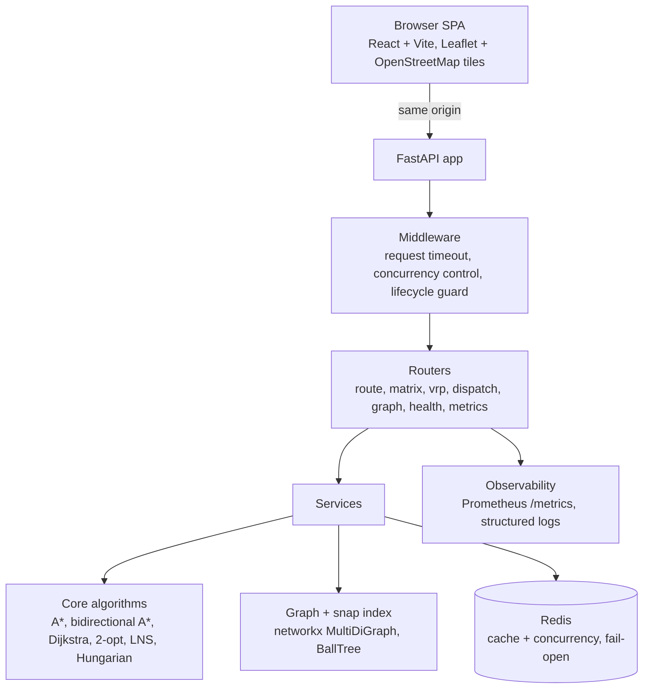

# CityRoute

**Last-mile delivery routing, road-distance matrices, vehicle routing and driver dispatch over an OpenStreetMap road network.**

One FastAPI process serves the JSON API *and* the React single-page app on the same origin, and the Kanpur Central road graph ships inside the repository, so a fresh clone answers routing requests without downloading anything.

[](https://github.com/anuushka-dev/CityRoute-V3/actions/workflows/ci.yml)
[](https://github.com/anuushka-dev/CityRoute-V3/actions/workflows/codeql.yml)
[](https://github.com/anuushka-dev/CityRoute-V3/actions/workflows/release.yml)


---

## Contents

- [What it does](#what-it-does)
- [Highlights](#highlights)
- [Architecture](#architecture)
- [Quick start](#quick-start)
- [API](#api)
- [Configuration](#configuration)
- [Testing and quality gates](#testing-and-quality-gates)
- [Deployment](#deployment)
- [Repository layout](#repository-layout)
- [Documentation](#documentation)
- [Engineering notes and trade-offs](#engineering-notes-and-trade-offs)
- [License](#license)

---

## What it does

CityRoute takes coordinates, driver positions and delivery orders and answers four families of questions over a real road network rather than straight lines:

| Question | Endpoint |
| --- | --- |
| What is the road route and distance between two points? | `GET /route`, `GET /route/compare` |
| What is the road distance between every pair of N points? | `POST /matrix` |
| In what order should one vehicle visit these stops? | `POST /vrp/greedy`, `POST /vrp/compare`, `POST /vrp/compare/advanced` |
| Which driver should take which order? | `POST /dispatch/compare` |

The UI in `frontend/` drives those endpoints as product workflows (route planning, stops, dispatch) plus an engineering console that renders the committed benchmark evidence.

---

## Highlights

| Area | What is implemented |
| --- | --- |
| **Routing** | A\* with a haversine heuristic and bidirectional A\* against a snap index, with a plain Dijkstra path kept as the reference the faster searches are checked against |
| **Distance matrices** | N\*N road-distance matrices built from graph edge lengths, with a separate road-cost variant that scores dispatch by snapped road geometry |
| **Vehicle routing** | Greedy nearest-neighbour, 2-opt and large-neighbourhood search (LNS); the advanced endpoint reports each stage's improvement over the previous one |
| **Dispatch** | Load- and slot-aware cost matrices, fairness measurement, and greedy versus Hungarian (optimal) assignment compared side by side |
| **Snapping** | A scikit-learn BallTree snap index built at startup, with a haversine nearest-node fallback when the index is unavailable |
| **Resilience** | Redis-backed caching and concurrency limiting that **fail open**: if Redis is unreachable the service keeps answering and readiness reports `degraded` instead of failing |
| **Observability** | Prometheus metrics at `/metrics`, request-timing middleware, structured logs, request timeouts, a lifecycle guard and graceful shutdown |
| **Single-origin delivery** | The SPA is mounted on the same app; client-side routes fall back to the SPA shell while a missing `/assets/*` file is a real 404 |
| **Startup that survives locked-down hosts** | `osmnx`/pandas are optional: the graph loads through networkx when a Windows Application Control policy blocks the compiled pandas DLLs |
| **Evidence** | Raw benchmark output for every engineering phase is committed under `benchmarks/` and rendered by the frontend console |

---

## Architecture



A request flows through the timeout and concurrency middleware to a router, which validates coordinates against the graph bounding box, snaps them to road nodes, then calls a service that runs the algorithm over the in-memory graph. Repeated matrix and dispatch requests are served from Redis when it is reachable.

```
app/
├── api/            routers: route, matrix, vrp, dispatch, graph, health, metrics, frontend
├── core/           A*, bidirectional A*, Dijkstra, 2-opt, LNS, Hungarian, cost matrices, timeouts
├── middleware/     request timeout, concurrency control, lifecycle guard
├── services/       routing, matrix, VRP, dispatch, readiness, shutdown
├── infrastructure/ Redis cache and resilience state (fail-open)
├── observability/  Prometheus metrics and reliability counters
├── utils/          graphio, snap index, node snapping, geo validation, cache keys, logger
└── main.py         app assembly, startup graph load, SPA mount
```

---

## Quick start

### Windows, one file

```powershell
powershell -ExecutionPolicy Bypass -File .\cityroute-v3.ps1
```

The menu offers: **1** run locally (API + Vite demo with hot reload), **2** run in Docker, **3** Docker Compose (API + Redis + Prometheus), **4** set up only, **5** check the setup. It verifies Python 3.11, Node and Docker, installs what is missing, creates `.venv` and `.env`, and picks a free port, because Hyper-V, WSL2 and Docker Desktop reserve TCP ranges that make Windows fail with `WinError 10013`. Skip the menu with `-Mode local`, `-Mode docker`, `-Mode setup` or `-Mode check`.

### Docker

```bash
# same runtime as the free-plan deploy: Node builds the SPA, python:3.11-slim serves it
docker build -f Dockerfile.render-free -t cityroute .
docker run --rm -p 8000:8000 cityroute

# API + Redis + Prometheus
docker compose up --build
```

### Manual (any OS)

```bash
python -m venv .venv && source .venv/bin/activate      # Windows: .venv/Scripts/Activate.ps1
python -m pip install -r requirements.txt
cp .env.example .env                                   # Windows: copy .env.example .env
python -m uvicorn app.main:app --reload --port 8010
```

```bash
# second terminal, for the demo UI with hot reload
cd frontend && npm install && npm run dev -- --port 5173
```

Prefer a single process like production? Build the bundle first, then run the API alone — it will serve the SPA at `/`:

```bash
cd frontend && npm ci && npm run build && cd ..
python -m uvicorn app.main:app --port 8010
```

### Check that it is up

```bash
curl http://localhost:8010/health          # process heartbeat
curl http://localhost:8010/health/live     # liveness
curl http://localhost:8010/health/ready    # 200 once graph, snap index and adjacency are ready
curl http://localhost:8010/graph/stats     # nodes, edges, load time, and which graph loader is in use
curl http://localhost:8010/api             # JSON service index ("frontend": "/" when the SPA is mounted)
```

Interactive API docs: `http://localhost:8010/docs`. The 12.7 MB Kanpur Central graph is already in `data/graphs/`, so the first start is fast and offline.

---

## API

| Method | Path | Purpose |
| --- | --- | --- |
| `GET` | `/` | Single-page app when a build exists, otherwise the JSON service index |
| `GET` | `/api` | JSON service index |
| `GET` | `/health` | Service health summary |
| `GET` | `/health/live` | Liveness: the process is up |
| `GET` | `/health/ready` | Readiness: graph, snap index and adjacency loaded (503 until they are) |
| `GET` | `/graph/stats` | Node/edge counts, load time, memory, graph loader |
| `GET` | `/graph/validate` | Is a coordinate inside the loaded graph's bounding box? |
| `GET` | `/graph/snap` | Snap a coordinate to the nearest road node |
| `GET` | `/route` | Shortest road route between two coordinates |
| `GET` | `/route/compare` | Same route computed by more than one algorithm |
| `POST` | `/matrix` | N\*N road-distance matrix |
| `POST` | `/vrp/greedy` | Visit order for one vehicle, greedy nearest-neighbour |
| `POST` | `/vrp/compare` | Greedy versus 2-opt improvement |
| `POST` | `/vrp/compare/advanced` | Greedy, 2-opt and LNS with per-stage improvements |
| `POST` | `/dispatch/compare` | Greedy versus Hungarian driver-to-order assignment |
| `GET` | `/metrics` | Prometheus metrics |
| `GET` | `/docs`, `/openapi.json` | OpenAPI documentation |

### Examples

```bash
# route
curl "http://localhost:8010/route?start_lat=26.465&start_lon=80.33&end_lat=26.48&end_lon=80.35"

# 2x2 road-distance matrix
curl -X POST http://localhost:8010/matrix -H 'Content-Type: application/json' \
  -d '{"locations":[{"id":"a","lat":26.45,"lon":80.33},{"id":"b","lat":26.48,"lon":80.35}]}'

# greedy visit order
curl -X POST http://localhost:8010/vrp/greedy -H 'Content-Type: application/json' \
  -d '{"start":{"lat":26.45,"lon":80.33},"stops":[{"lat":26.46,"lon":80.34},{"lat":26.47,"lon":80.35}]}'

# greedy vs optimal assignment of two drivers and two orders
curl -X POST http://localhost:8010/dispatch/compare -H 'Content-Type: application/json' \
  -d '{"drivers":[{"driver_id":"d1","lat":26.455,"lon":80.335},{"driver_id":"d2","lat":26.47,"lon":80.35}],"orders":[{"order_id":"o1","pickup_lat":26.46,"pickup_lon":80.34},{"order_id":"o2","pickup_lat":26.48,"pickup_lon":80.36}]}'
```

Every POST body also accepts `matrix_algorithm` and `use_cache`, and the VRP endpoints accept `return_to_start`; `/vrp/compare/advanced` exposes the LNS knobs (`lns_max_iterations`, `lns_destroy_fraction`, `lns_no_improvement_limit`, `lns_random_seed`) and `keep_trace` for a step-by-step trace. Full schemas: `/docs`.

---

## Configuration

Every setting is a `CITYROUTE_`-prefixed environment variable read case-insensitively (see `app/config.py` and `.env.example`). The ones that change behaviour most:

| Variable | Default | Purpose |
| --- | --- | --- |
| `CITYROUTE_GRAPH_FILE` | `kanpur_central.graphml` | GraphML file inside `CITYROUTE_GRAPH_DIR` |
| `CITYROUTE_GRAPH_DIR` | `data/graphs` | Where the graph extract lives |
| `CITYROUTE_CITY_NAME` | `Kanpur Central, Uttar Pradesh, India` | Display name for the loaded graph |
| `CITYROUTE_SERVE_FRONTEND` | `true` | Serve the built SPA at `/` when present |
| `CITYROUTE_REDIS_URL` | `redis://localhost:6379/0` | Cache and concurrency backend |
| `CITYROUTE_REDIS_FAIL_OPEN` | `true` | Keep serving when Redis is down |
| `CITYROUTE_READINESS_REQUIRE_REDIS` | `false` | Make Redis a readiness requirement |
| `CITYROUTE_METRICS_ENABLED` | `true` | Expose `GET /metrics` |
| `PORT`, `WEB_CONCURRENCY` | `8000`, `1` | Uvicorn port and worker count (each worker loads the graph) |

---

## Testing and quality gates

```bash
python -m pytest                          # 626 tests
python -m pytest tests/test_multiworker_consistency.py   # process-level consistency
python -m ruff check .                    # lint
python -m ruff format --check .           # format
```

| Gate | What runs |
| --- | --- |
| `ci.yml` | Ruff check + format on the whole repository, the pytest suite against a Redis service container, the frontend build |
| `cityroute-free-ci-cd.yml` | Backend (Ruff, `compileall`, pytest + Redis), frontend (`npm ci`, Vite build, bundle checks), a 512 MB container smoke test (readiness, `/health`, SPA at `/`, index at `/api`, deep-link fallback, missing-asset 404), and the optional Render deploy hook |
| `codeql.yml` | CodeQL analysis for Python and JavaScript |
| `release.yml` | Tagged release packaging |

Tests cover the algorithms (A\* admissibility, bidirectional correctness, greedy/2-opt/LNS behaviour, Hungarian optimality), the API contracts, cache and concurrency behaviour, failure and timeout paths, multi-worker consistency, frontend serving, and the health/readiness contract.

---

## Deployment

| Target | How |
| --- | --- |
| Docker | `docker build -f Dockerfile.render-free -t cityroute . && docker run -p 8000:8000 cityroute` |
| Compose | `docker compose up --build` — API on 8010, Redis, Prometheus on 9090 |
| Render | `render.yaml` blueprint: free plan, health-checked at `/health/ready`, Redis explicitly fail-open |
| Any host / VM | `uvicorn app.main:app --host 0.0.0.0 --port $PORT` with `WEB_CONCURRENCY=1` |

Run Uvicorn from the repository root so `frontend/dist` and `data/graphs` resolve. Keep `WEB_CONCURRENCY=1` on a 512 MB plan: every worker loads its own copy of the graph. `DEPLOYMENT.md` has the environment table, post-deploy verification commands and troubleshooting.

---

## Repository layout

```
CityRoute-V3/
├── app/                 FastAPI service (see the Architecture section)
├── frontend/            React + Vite SPA, .jsx sources, Leaflet map, engineering console
├── tests/               626 pytest tests
├── benchmarks/          raw benchmark evidence per engineering phase
├── data/graphs/         kanpur_central.graphml (12.7 MB, committed on purpose)
├── scripts/             benchmark and evidence runners
├── prometheus/          scrape configuration for Compose
├── .github/workflows/   CI, CI/CD, CodeQL, release
├── Dockerfile           general-purpose image
├── Dockerfile.render-free  smaller image for the free hosting tier
├── docker-compose.yml   API + Redis + Prometheus
├── docker-compose.phase11-multiworker.yml
├── render.yaml          Render blueprint
├── cityroute-v3.ps1     one-file Windows runner (local, Docker, Compose, setup, check)
├── setup.ps1 run-local.ps1 run-docker.ps1 (+ .cmd wrappers)
├── README.md QUICKSTART.md DEPLOYMENT.md CHANGELOG.md CONTRIBUTING.md SECURITY.md
└── docs/ENGINEERING-LOG.md   the phase-by-phase engineering history
```

---

## Documentation

| Document | Contents |
| --- | --- |
| [QUICKSTART.md](QUICKSTART.md) | Two-minute version of the three setup paths, ports, and common Windows problems |
| [DEPLOYMENT.md](DEPLOYMENT.md) | Docker, Compose, Render, plain hosts, environment variables, verification, troubleshooting |
| [docs/ENGINEERING-LOG.md](docs/ENGINEERING-LOG.md) | How the project grew phase by phase, with the measurements behind each decision |
| [frontend/README.md](frontend/README.md) | Frontend module map and build details |
| [FRONTEND-DEPLOYMENT-REPORT.md](FRONTEND-DEPLOYMENT-REPORT.md) | The frontend conversion, single-service deployment, and the blocked-DLL startup fix, with every verification performed |
| [CHANGELOG.md](CHANGELOG.md) | Release history |
| [CONTRIBUTING.md](CONTRIBUTING.md) | Setup for contributors, test and lint gates, commit conventions |
| [SECURITY.md](SECURITY.md) | Supported versions and how to report a vulnerability |

---

## Engineering notes and trade-offs

- **`osmnx` and pandas are optional at runtime.** They are imported lazily (`app/utils/graphio.py`). Where a Windows Application Control policy blocks the compiled pandas DLLs that `osmnx` pulls in, the service logs one warning and loads the GraphML through networkx instead — still a `MultiDiGraph`, with attributes coerced to the right types. `/graph/stats` reports which loader ran as `graph_loader`. Only downloading a graph for a new area genuinely requires `osmnx`; without it that one call raises a clear error instead of an import traceback.
- **The 12.7 MB graph is committed on purpose.** A clone, a CI run and a container build all work with no network access and no Overpass rate limits, which is the difference between a demo that starts and a demo that waits on someone else's API.
- **Redis is optional.** Defaults point at `redis://localhost:6379/0`; without it, caching and the distributed concurrency limit are skipped, readiness reports `degraded`, and every endpoint still answers.
- **Nothing in a request path costs money or needs a key.** Routing, matrices, VRP and dispatch run locally over the bundled OpenStreetMap extract; map tiles are standard OSM raster tiles with attribution; metrics are self-hosted Prometheus. The only network dependency is optional graph download.
- **Benchmarks are committed raw**, not summarised, so any number in the engineering log can be re-derived from the JSON next to it.

---

## License

[MIT](LICENSE) © 2026 Anushka
